 

 

**Computer Science graduate, Cybersecurity track.** 
**Full-time Software Engineer shipping production code, and builder of my own SaaS.**

 

## ⚡ About me

I like building software that real people use. At **Pharos Solutions** I work on a live multi-tenant school platform, fixing real production problems and shipping features across backend and frontend. Outside work I designed, built and deployed **UniAct**, a SaaS platform for universities, from the architecture to the cloud deployment.

My degree is in cybersecurity, so I think about access control, data handling and failure modes in everything I build. I'm comfortable anywhere in the software stack, and curious about all of it.

 

## 🧭 What I do

<table>
<tr>
<td width="25%" valign="top" align="center">
<h3>🧱 Software</h3>
Backend APIs, full-stack web apps, cross-platform mobile with Flutter, multi-tenant systems.
</td>
<td width="25%" valign="top" align="center">
<h3>☁️ Cloud and DevOps</h3>
AWS (4 Academy certifications), CI/CD with GitHub Actions, Docker, Linux administration on RHEL.
</td>
<td width="25%" valign="top" align="center">
<h3>🛡️ Security</h3>
IAM, RBAC, JWT and OAuth 2.0, Linux hardening, secure application design. Interested in both offense and defense.
</td>
<td width="25%" valign="top" align="center">
<h3>🔧 Reliability</h3>
Debugging production issues, data integrity, background jobs, real-time sync, maintainable code.
</td>
</tr>
</table>

 

## 🚀 Featured work

<table>
<tr>
<td colspan="2" valign="top">
<h3><a href="https://github.com/UniAct">UniAct</a> &nbsp;·&nbsp; <a href="https://uniact.website">Live at uniact.website</a></h3>
A multi-tenant SaaS platform for universities. A central control plane provisions tenants, and every university runs isolated on its own subdomain. Includes an <b>offline-first QR attendance system</b> (scans cached in SQLite, auto-synced when back online), RBAC, background jobs, and AI-powered learning groups that auto-enroll students.  

</td>
</tr>
<tr>
<td width="50%" valign="top">
<h3><a href="https://github.com/Arsany-Osama/secure-distributed-system-observability-dashboard">Secure Observability Dashboard</a></h3>
Real-time distributed system template: Nginx with TLS and rate limiting, JWT auth, RabbitMQ worker queues and PostgreSQL audit tracing. One command to run.  

</td>
<td width="50%" valign="top">
<h3><a href="https://github.com/Arsany-Osama/UniSecure-IAM">UniSecure-IAM</a></h3>
Open-source identity and access management platform on Keycloak: secure authentication, RBAC, user provisioning and admin automation.  

</td>
</tr>
<tr>
<td width="50%" valign="top">
<h3><a href="https://github.com/Arsany-Osama/Q-and-A-system">Q&amp;A Community Platform</a></h3>
Reddit-style app with Auth0 and Okta identity integration, admin moderation panel, reported-content queue, RBAC and server-side input sanitization.  

</td>
<td width="50%" valign="top">
<h3><a href="https://github.com/Arsany-Osama/Real-time-chatting-with-authentication">Real-time Chat with Auth</a></h3>
Rails app with Devise authentication, CanCanCan authorization, WebSockets for live messaging and Google OAuth.  

</td>
</tr>
</table>

 

## 🧰 Toolbox

**Languages** 

**Frameworks** 

**Databases** 

**Cloud, DevOps and Tools** 

**Auth and Security** 

 

## 🛣️ Journey

| When | What |
|:--|:--|
| **2026** | Graduated with Honors, moved to full-time Software Engineer|
| **2025** | Joined Pharos Solutions as an intern, then part-time, working on a multi-tenant platform in Ruby on Rails |
| **2024** | Linux System Administration internship at ITI: security hardening on RHEL nodes · AWS Academy Foundations |
| **2023** | Linux Administration I & II (ITI) · Data Structures |
| **2022** | Started B.Sc. Computer Science (Cybersecurity track) · ECPC competitive programming |

**AWS Academy:** Foundations (2024) · Security (2025) · Architecture (2026) · Developing (2026)

 

## 📫 Let's connect

Open to conversations about software engineering, cloud and security roles.

